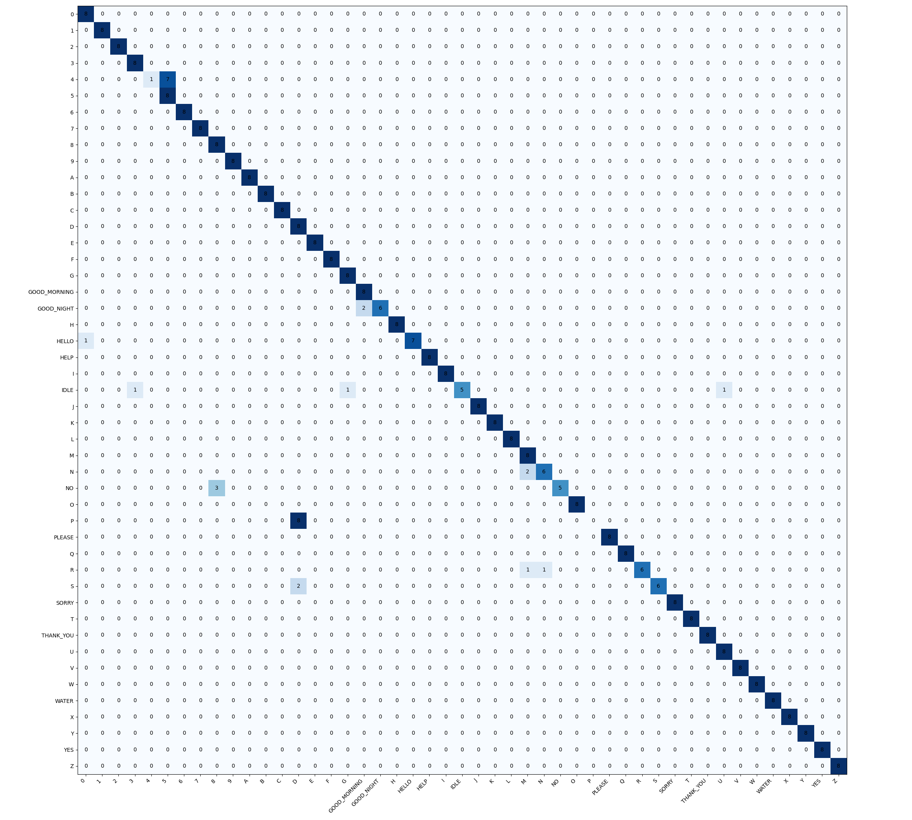

# Indian Sign Language Recognition

Real-time Indian Sign Language (ISL) recognition running on CPU using **MediaPipe Holistic** (upper-body pose + both hands) and a 2-layer LSTM.

The entire pipeline is ~320 lines of Python across 4 files. It comes trained on 47 ISL classes (`A–Z`, `0–9`, 10 conversational signs, and `IDLE`), and is built to scale easily—you can add new signs or adapt it to another sign language (ASL, BSL, custom gestures) just by updating the sign dictionary and recording new sessions.

## How it works

1. **Features (`162` values per frame):** Hand landmarks alone lose where the hands are relative to the body (e.g. `THANK_YOU` at the chin vs. `HELLO` at the forehead) and how they move. Each frame combines:
   - Wrist-centered, palm-scaled 3D coordinates for both hands (`2 x 63`)
   - Shoulder-normalized 3D wrist coordinates (`2 x 3`) and hand-detected flags (`2`)
   - Shoulder-normalized 2D upper-body pose points (`11 x 2`)
   - Frame-to-frame wrist velocity across a resampled 30-frame window (`6`)
2. **Recording modes (`stream` vs `reps`):**
   - `stream` (static signs): hold the pose for 8 seconds while moving/tilting your hand slightly. [`train.py`](src/isl/train.py) slices each take into 8 evenly spaced ~2s windows.
   - `reps` (dynamic signs with motion): auto-loops 8 back-to-back 2-second clips so you don't have to touch the keyboard between reps.
3. **Session-based split:** Recordings are saved by session (`session_1`, `session_2`, ...). When training on 2+ sessions, the latest session is held out as the test set and augmentation (zero-masked Gaussian noise, scale jitter, edge-padded frame shifts) is applied only to training windows.

## Setup

Requires **Python 3.10** (needed for `mediapipe==0.10.14` and `tensorflow==2.15.0`).

```powershell
py -3.10 -m venv venv
.\venv\Scripts\Activate.ps1
pip install -r requirements.txt
pip install -e . --no-build-isolation
pytest
```

## Usage

### 1. Run live recognition (using the included 47-class model)
```powershell
python -m isl.live
```
Press `Q` to quit.

### 2. Record data
Clips are saved to `data/raw/session_<N>/<SIGN>/*.npy`. If you quit early and re-run the same command, already-recorded signs in that session are skipped automatically.

```powershell
# Record a quick 4-sign pilot (IDLE, HELLO, THANK_YOU, A)
python -m isl.collect --pilot --session 1
python -m isl.collect --pilot --session 2

# Record all 47 signs for a session
python -m isl.collect --session 1
python -m isl.collect --session 2

# Record or redo a single sign
python -m isl.collect --session 1 --sign HELLO
```

**Window controls:** `SPACE` start · `R` redo current clip · `N` skip sign · `B` previous sign · `Q` quit

### 3. Train and evaluate
```powershell
python -m isl.train
```
Prints the classification report on the held-out session and saves `model.keras`, `labels.json`, and `confusion_matrix.png` to `artifacts/`.

## Using your own signs or another sign language

Edit [`SIGNS`](src/isl/core.py#L24-L31) in [`src/isl/core.py`](src/isl/core.py) and set each class to `"stream"` (static pose) or `"reps"` (dynamic motion):

```python
SIGNS = {
    "IDLE": "stream",
    "HELLO": "reps",
    "A": "stream",
}
```
Then record at least two sessions and run `python -m isl.train`. The model output size, label list, confusion matrix, and live overlay update automatically from the folders in `data/raw/`.

## Results (47-class held-out session)

Trained on `session_1` (331 windows, augmented 3x) and tested on a separate recording session (`session_2`, 376 windows, 8 per class) on a laptop CPU:

- **Test Accuracy:** 92.0% (346 / 376)
- **Macro Precision / Recall / F1:** 0.929 / 0.920 / 0.909
- **Perfect 1.000 F1:** 31 / 47 classes

| Category | Classes | Mean Recall | Notes |
|---|---|---|---|
| Conversational words (`reps`) | 10 (`HELLO`, `THANK_YOU`, `YES`, `NO`, `PLEASE`, `SORRY`, `HELP`, `GOOD_MORNING`, `GOOD_NIGHT`, `WATER`) | 92.5% | `GOOD_NIGHT` occasionally confuses with `GOOD_MORNING` (both start with the same `GOOD` gesture at the chin). |
| Digits `0–9` (`stream`) | 10 | 91.3% | 9/10 digits hit 100% recall; `4` confuses with `5` when the tucked thumb is occluded. |
| Alphabet `A–Z` (23 `stream`, 3 `reps`: `H`, `J`, `Y`) | 26 | 93.3% | 21/26 letters hit 100% recall (including dynamic `H`, `J`, `Y`). Two-handed `P` confuses with `D`, and `N` occasionally confuses with `M`. |
| `IDLE` (`stream`) | 1 | 62.5% | In `isl.live`, windows where hands are absent for >70% of frames bypass the model and default to `IDLE`. |



## Project layout

```text
src/isl/
  core.py      # Vocabulary, MediaPipe Holistic setup, 162-D feature extraction
  collect.py   # Webcam collector (stream & auto-rep modes)
  train.py     # Session-split loader, augmentation, LSTM training & evaluation
  live.py      # Real-time webcam recognition
tests/
  test_core.py # Feature invariance, window slicing, and zero-masked augmentation tests
artifacts/     # Trained model, labels.json, and confusion_matrix.png
```

## License
MIT
